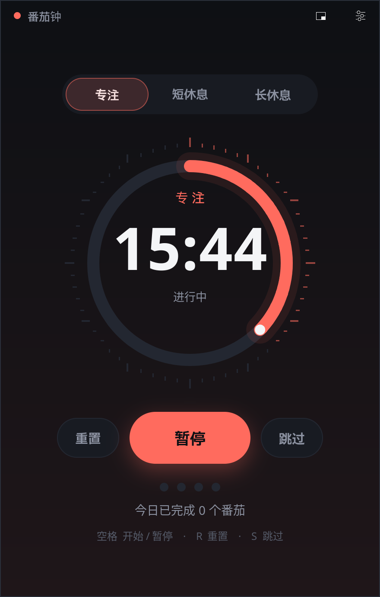
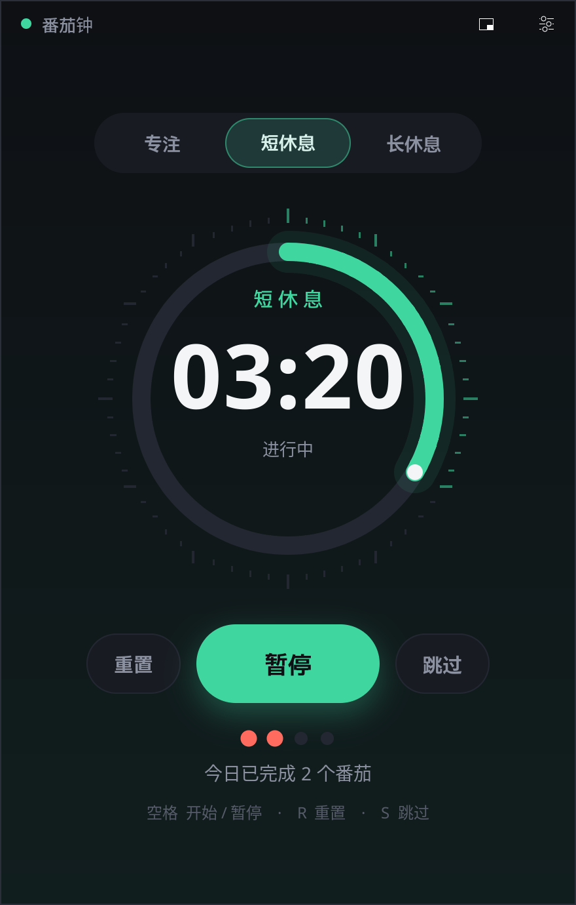
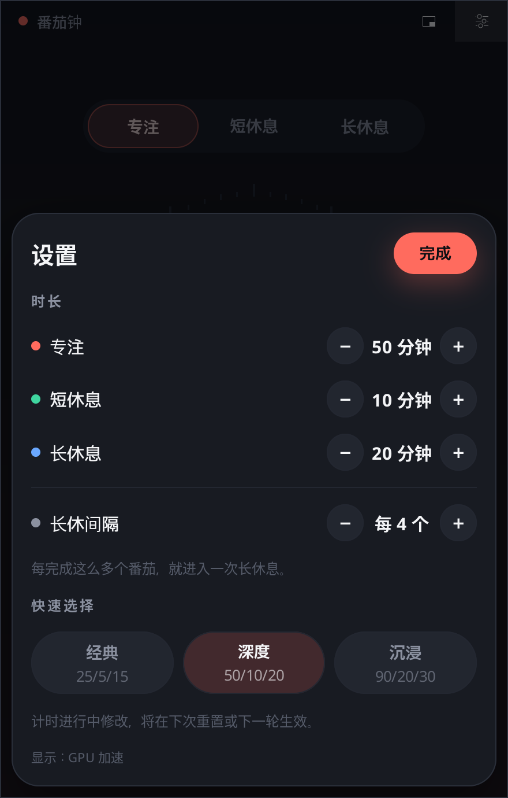
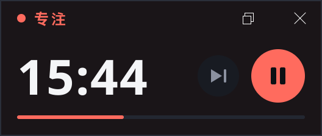
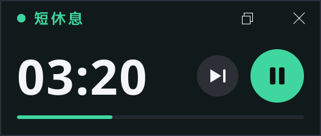

# 番茄钟 · Pomodoro (MyGo)

一个用纯 Go 写的桌面番茄钟，界面基于纯 Go 桌面框架 [MyGo](https://github.com/egoist/mygo)（`github.com/egoist/mygo` v0.5.5）的原生 `ui` 包，没有 WebView、没有 CGO、没有前端工具链。深色主题，简体中文界面，简洁、有动效，并且很省资源。

<p align="center">
  
  
  
</p>

## 功能

- **三种模式**：专注 / 短休息 / 长休息，每个模式一种主题色，圆环倒计时，窗口标题实时显示剩余时间。
- **可调时长**：专注 1–90 分钟，短休息 1–30 分钟，长休息 1–60 分钟；点击时间或设置面板里调整；还可设置「每几个番茄一次长休息」。
- **三个预设**：经典 25/5/15、深度 50/10/20、沉浸 90/20/30。
- **迷你置顶窗口**：标题栏设置按钮左边的按钮（或按 `M`）把窗口变成一个小的、无边框、永远置顶的窗口，只显示剩余时间、当前模式、细进度线、跳过和开始/暂停；拖动窗口主体即可移动，还原按钮（或 `M` / `Esc`）回到完整窗口。迷你模式及其位置会被记住。
- **切换确认**：专注进行到一半时点击其他模式、或按 `S` 跳过，会先弹出应用内确认（`Enter` 确认，`Esc` 取消），不会悄悄清空进度；在时间还没动过时则直接切换。会话进行中修改时长，从下一个会话开始生效，不会清空当前进度。
- **快捷键**：`Space` 开始/暂停，`R` 重置，`S` 跳过，`M` 迷你窗口，`Esc` 关闭面板/取消。
- **系统通知**：一个专注或休息结束时弹出通知。
- **今日计数**：记录今天完成的番茄数，重启后保留，隔天自动清零。
- **设置持久化**：时长、迷你模式等保存在用户配置目录下的 `pomodoro-mygo/settings.json`（Windows 上是 `%AppData%\pomodoro-mygo\`），今日计数在同目录的 `state.json`；窗口位置与大小由 MyGo 另行记住。
- **自绘标题栏**：与系统窗口按钮（最小化/最大化/关闭）对齐的深色标题栏，支持系统文字缩放。

### 截图

| 迷你窗口（专注） | 迷你窗口（休息） | 切换确认 |
|---|---|---|
|  |  |  |

## 构建

需要 **Go 1.27+**。MyGo 的命令行工具已声明为 `go.mod` 里的 tool，无需单独安装。

```sh
go vet ./...                                   # 静态检查
go test .                                      # 测试（无窗口，使用 MyGo 的 Tester）
go tool mygo dev                               # 开发运行
go tool mygo build -platform windows/amd64     # 在 build/ 下生成 exe 和安装包
```

`mygo.json` 里是应用名、标识符和版本。生成 Windows 安装包需要安装 [NSIS](https://nsis.sourceforge.io/)（`makensis`）；本项目的发布版本是在 Linux 上交叉编译、用 NSIS 打包的。便携版就是 `build/windows-amd64/` 里的 exe。

生成截图：`SHOTS=<目录> go test -run Screenshots .`。

## 性能说明

- 运行中的计时器大约每秒重建界面 2 次（数字变化时以及半秒后），而不是每次屏幕刷新都重绘；圆环的几何形状只构建一次，每帧只裁剪路径。迷你窗口每秒只重绘一次。
- 当窗口由 CPU 绘制时（没有 GPU，或 Windows 的软件渲染器），应用会自动去掉发光、按钮阴影和背景渐变。设置面板里会显示当前使用的渲染器。
- 测量一帧的开销：`FRAMECOST=1 MYGO_FRAME_STATS=all go test -count=1 -run FrameCost -v .`。在真机上可以在命令行里设置 `MYGO_FRAME_STATS=all` 再运行 exe；`MYGO_GPU=0` 可强制使用 CPU 渲染做对比。

## 已知限制

- 作者没有在真实 Windows 上做过系统性测试：除用户的反馈（例如标题栏按钮间距的问题已据此修复）外，界面主要是在 Linux 上用 MyGo 的无窗口 Tester 渲染和检查的，安装包只在 Wine 里做过启动检查。
- **安装包没有代码签名**，Windows SmartScreen 可能会提示「已保护你的电脑」，需要点「更多信息 → 仍要运行」。可以用 Release 里的 `SHA256SUMS.txt` 校验文件。
- 迷你窗口的「永远置顶」行为没有在真机上验证过。
- 目前只提供 Windows 构建，界面语言只有简体中文。

欢迎提 Issue 和 PR。

## English

A small Pomodoro timer written in pure Go with [MyGo](https://github.com/egoist/mygo) (v0.5.5), a pure-Go desktop framework with a native `ui` package — no WebView, no CGO. Dark theme, Simplified Chinese UI.

**Features:** focus / short break / long break with per-mode accent colors, adjustable lengths and three presets, an always-on-top mini window (`M`), a confirmation prompt before switching mode or skipping a session that has progress, shortcuts (`Space` start/pause, `R` reset, `S` skip, `M` mini), desktop notifications, a persistent daily counter, and settings stored in `<UserConfigDir>/pomodoro-mygo/`.

**Build:** Go 1.27+ is required. `go test .`, `go tool mygo dev`, and `go tool mygo build -platform windows/amd64` (NSIS needed for the installer).

**Caveats:** not systematically tested on real Windows (mostly rendered and tested headlessly on Linux with MyGo's Tester; the installer was only smoke-tested under Wine), the installer is unsigned so SmartScreen will warn, and the mini window's always-on-top behavior is unverified on a real machine.

## 致谢 / Credits

用 [MyGo](https://github.com/egoist/mygo) 构建。Built with MyGo.

## 许可证 / License

[MIT](LICENSE) © 2026 Keegan Bozde
